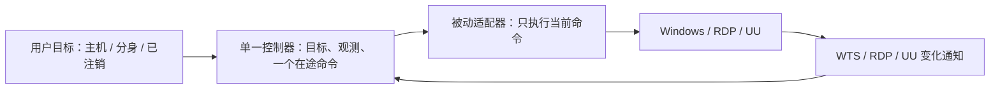

# 单一桌面控制器实验

分支：`experiment/unified-desktop-controller`，基于 PR #6 的 `0bb594b`。

这是一个**可执行的架构原型**。当前只运行受控适配器与模拟场景，尚未替换 WPF 应用的
`ChildSessionService` / `UuViewLockService` / `ServiceRecovery`。没有调用真实 WTS、RDP COM 或 UU 服务。

## 要消除什么

原实现让启动、视角锁定、RDP 重试、UU 修复分别维护进行中状态，再协调它们的取消、互斥与收尾。
本实验取消这些独立决策循环，只有一个控制器能发出改变设备的命令。
三个外部系统的观测仍然存在；把它们放在同一个 record 不会让 Windows 操作原子化。



更重要的改变是收紧合法稳定状态：

| 目标 | 分身会话 | RDP | UU 落点 |
|---|---|---|---|
| 主机 | 可存在，保持断开 | 保持断开 | 有串流端时应为主机 |
| 分身 | 已存在且活跃 | 已连接 | 有串流端时应为分身 |
| 已注销 | 不存在 | 已断开 | 不再为了纠正视角创建分身 |
| Observe | 不主动改变 | 不主动改变 | 仍完成自己已承担的服务恢复 |

**行为差异：主机目标不再执行 `keep_child_connected` 背景重连。**
分身程序继续运行，但再次切到分身要重新连 RDP。这是通过减少允许的中间状态，删除一条反向控制路径，
不是单纯替换锁的实现。原型也未复刻 UI 的两个开关、热键、凭据确认、自动启动目标程序等完整产品流程。

## 论文依据与适用边界

以下是对原文思想的工程应用；这些论文没有证明本实验实现正确。

- **Harel, 1987, Statecharts: A Visual Formalism for Complex Systems.**
  用层次化状态与事件表达复杂响应行为，避免把状态拆成散落的布尔值。
  本实验将用户目标、设备观测和服务恢复阶段放在一份规范状态中，转移由纯函数计算。
  Statecharts 可以表达并发，并不自动要求单一控制者；单一控制者是本实验额外的架构选择。
  [原论文](https://www.weizmann.ac.il/math/harel/sites/math.harel/files/users/user50/Statecharts.pdf)
- **Hewitt, Bishop, Steiger, 1973, A Universal Modular ACTOR Formalism for Artificial Intelligence.**
  用消息组织控制与数据流。本实验采用一个邮箱拥有状态，外部适配器只返回消息。
  邮箱不等待设备 I/O，新的注销目标可以在设备操作未完成时被接收。
  Actor 名称本身不能消除死锁；“不在邮箱内等待设备”和“一个在途设备命令”是这里实际采用的约束。
  [原始会议论文](https://ijcai.org/proceedings/1973/31)
- **Dijkstra, 1974, Self-stabilizing systems in spite of distributed control.**
  关注系统从非合法状态重新收敛到合法状态。本实验以当前目标重新规划，接纳旧命令实际造成的变化，
  再收敛到新目标，不靠丢弃旧结果假装系统没有变化。
  原文证明针对特定算法；本实验只有有界测试，收敛还依赖命令最终完成、观测最终到达等环境假设。
  [作者档案原文](https://www.cs.utexas.edu/~EWD/transcriptions/EWD04xx/EWD426.html)
- **Hellerstein & Alvaro, Keeping CALM: When Distributed Consistency Is Easy, 2019/2020.**
  CALM 将可免协调的一致分布式计算与单调性联系起来。关闭会话、撤销重连等操作会撤销既有事实，
  不能直接套用“无协调合并”。本实验将这些决定放回一个有顺序的拥有者，避免复制成多个控制器。
  这是设计启发，不是把该定理直接当成本机 WTS/COM 协议的证明。
  [作者论文](https://arxiv.org/html/1901.01930)

## 已实现的约束

1. 一个目标，一份规范状态，一个在途命令；没有跨服务 `SemaphoreSlim` 或相互等待。
2. 设备 I/O 在邮箱外执行，即使适配器同步阻塞，控制器仍可处理新目标。
3. 新目标立即取代旧意图，但已发出的设备命令仍要回报；旧命令结果按真实世界处理，旧失败不能阻断新意图。
   命令仅被接受或结果未知时，同一个在途位置保留为 AwaitingConfirmation，直到新观测确认实际完成；
   不在状态尚未变化时反复发同一个命令，也不提前宣告空闲。
4. 观测来自一个适配器分配的递增 revision。旧 revision 和重复命令回报不能覆盖当前状态。
   它只提供进程内观测顺序，不能证明外部设备快照原子或语义上最新。
5. 只有显式的分身目标能给出一次创建权限；接管已有会话或发出创建命令就消耗权限，通知不能复活已注销分身。
6. 服务停止一旦接受或结果不确定，就保留等待停止并重新启动的责任；取消调用方等待或关闭控制器不能丢弃责任。
7. 停止被明确拒绝时显示失败并释放在途命令；未知查询不会制造永远忙碌的后台任务。
8. 失败需要显式 Retry；恢复自己结束的串流端使用同一控制器的 Tick，不另起恢复服务。

这会牺牲一部分切换时延：旧命令尚未确认完成时，新目标可立即记下，但下一条设备命令仍须等待。
它保证的是决策顺序与责任归属，不是让已接受的 Windows 命令可以瞬间撤销。

## 运行与验证

在仓库根目录，使用 .NET 10 或更高版本：

```powershell
dotnet run --project experiments/UnifiedDesktop -c Release
dotnet test experiments/UnifiedDesktop.Tests -c Release
dotnet test DesktopTwin.sln -c Release
```

也可以运行 `powershell -NoProfile -ExecutionPolicy Bypass -File experiments/verify.ps1` 完成两套建置、测试与演示。

演示打印“主机 → 分身 → 服务修复 → 注销 → 迟到观测”的完整命令轨迹。
测试覆盖旧请求完成、新意图抢占、创建权限、延迟服务停止、重复回报、未知结果与关闭收尾；
另外枚举 3,000 种观测组合检查命令前置条件，并运行 512 个固定种子、每个 64 个事件的交错轨迹。
这些是有限模型与运行时测试，不是对所有 Windows 执行情况的形式化证明。

本分支已验证：实验测试 **22/22**，原应用测试 **129/129**，两套 Release 建置均为 0 警告、0 错误；
演示以 8 条顺序设备命令完成场景，终态为 Stopped。

## 怎样进一步去掉三个外部状态

物理层面真正少一个状态源，需要改变集成边界，例如 UU 直接接受 Windows 目标会话 ID，
让切视角不再依赖操纵 RDP 来间接影响 UU 的选择。
本次查到的[网易官方接入协议](https://github.com/netease-uuyc/uuremote-integration-guide)
描述的是移动端绑定设备、按设备标识发起远控；文档的远控参数没有 Windows session ID。
因此没有以未经确认的接口假设替换当前路径，也不能据此断言所有私有接口都不存在。

## 接入 WPF 前必须完成

- 用 WTS/RDP/SCM 的单次命令实现 `IDesktopPlatform`，校验捕获的会话 ID，不能在适配器里调用旧的高层启动/修复流程。
- WTS、RDP、服务通知都触发当前状态的重新采样；不能把迟到回呼的旧负载重新编号后当作最新快照。
  确认快照的未知字段和采样顺序，避免把一次“读不到”当作“会话不存在”。
- 切换到新控制器时停止旧的 UU 纠正、RDP 自动重试和服务恢复循环，防止新旧两套决策同时写设备。
- UI 的启动前确认要作为事件阶段接入；只在显式确认后授予创建权限，保留现有凭据与系统变更说明。
- 明确“关闭锁定”与“取消等待”的产品语义。原型以 Observe 表示停止纠正，调用方取消仅结束自己的等待。
- 接回 hotkey、锁定开关、窗口、凭据和自动启动功能，再在管理员环境做真实联调。
- 未决设备命令或失败的已接受服务恢复会阻止优雅关闭完成。调用方可停止等待，但不能把此状态伪装成已恢复。

这个分支验证的是减少独立决策者与合法状态数量的可行性，尚未证明真实 UU 的会话选择规律在所有版本都成立。
